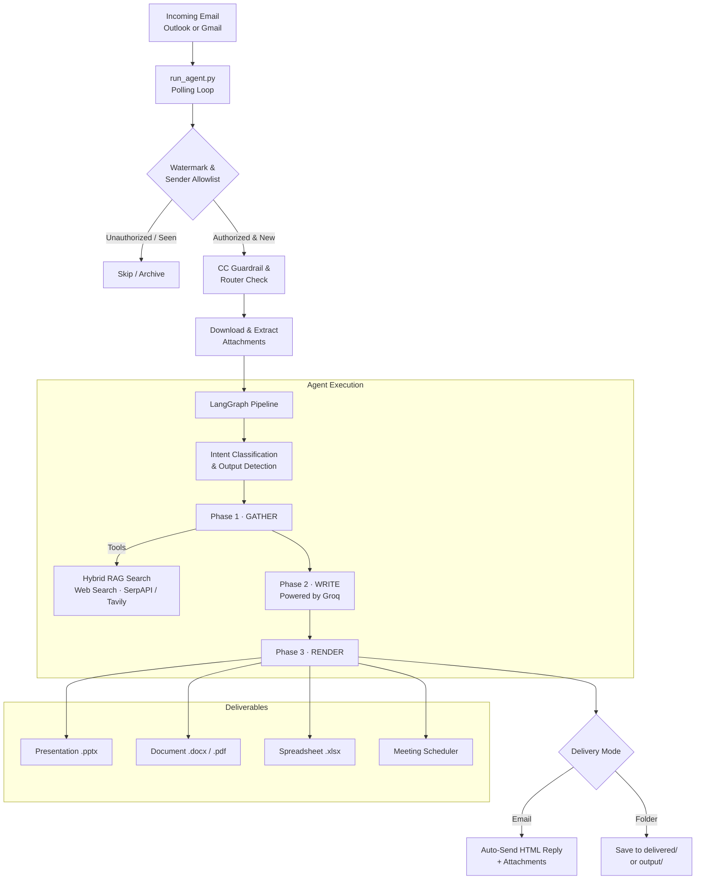

<div align="center">

# ⚡ PhantomOps
### Autonomous Enterprise AI Operations Agent & Executive Email Copilot
#### Codename: *Sally* · RAG-Optimised Edition

[](https://www.python.org/)
[](https://github.com/langchain-ai/langgraph)
[](https://groq.com/)
[](https://www.trychroma.com/)
[](https://learn.microsoft.com/en-us/graph/overview)
[](https://microsoft.com)
[]()

> **PhantomOps** is a production-grade autonomous AI operations agent that lives inside your corporate mailbox. It reads emails, understands complex multi-step instructions, produces polished executive deliverables — presentations, reports, spreadsheets, and RFP responses — and replies automatically, all without human intervention.

</div>

---

## 📑 Table of Contents

1. [Overview](#-overview)
2. [Key Capabilities](#-key-capabilities)
3. [Architecture & Pipeline](#-architecture--pipeline)
4. [Optimised RAG Knowledge Base](#-optimised-rag-knowledge-base)
5. [Repository Structure](#-repository-structure)
6. [Getting Started](#-getting-started)
7. [LLM Configuration](#-llm-configuration)
8. [Runtime Configuration](#-runtime-configuration-agent_configyaml)
9. [Operator UI](#-operator-ui--control-center)
10. [Security Best Practices](#-security--best-practices)

---

## 🌟 Overview

PhantomOps operates as an **autonomous executive operations co-worker**, not a chatbot. End users interact with it through standard corporate email — no new dashboards, portals, or apps required.

| Capability | Description |
|---|---|
| 📬 **Zero-Friction Email Channel** | Interacts through existing corporate email threads — no extra tooling for end users |
| 🧠 **Intelligent Triage** | Distinguishes direct addressing from CC; maintains multi-turn conversation context |
| 📄 **Enterprise Deliverables** | Produces native `.pptx`, `.docx`, `.pdf`, and `.xlsx` files from corporate templates |
| 🔍 **Optimised Hybrid RAG** | ChromaDB vector retrieval + BM25 keyword search fused via Reciprocal Rank Fusion (RRF) |
| ⚡ **Ultra-Fast Inference** | Groq-powered near-instant responses and document generation |
| 🪟 **100% Native Windows** | Runs out-of-the-box on Windows 10/11 via single-click batch scripts — no Docker required |

---

## 🚀 Key Capabilities

### 1 · Autonomous Mailbox Ingestion & Triage

- **Dual Mailbox Support** — Microsoft 365 (Outlook) via the Microsoft Graph API, or Gmail via Google OAuth.
- **Downtime-Safe Watermarking** — Tracks a persistent `last_email_ts` watermark in SQLite; emails received while the agent is offline are processed on restart.
- **Thread & CC Guardrails** — Stays silent if CC'd unless explicitly addressed; preserves all original recipients when replying.
- **Multi-Agent Routing** — Multiple agents (e.g. *Sally* and *Claude*) can share one mailbox; an LLM router (`email_router.py`) sorts inbound mail into dedicated folders.
- **Anti-Spam & Deduplication** — Cross-process SQLite lease locks prevent duplicate processing.

### 2 · Multi-Format Document Ingestion & Vision

- **Broad File Support** — Native extraction for PDF (`pdfplumber` + `PyMuPDF`), Word (`python-docx`), PowerPoint (`python-pptx`), Excel/CSV (`pandas` + `openpyxl`), plain text, and Markdown.
- **Tesseract OCR** — Automatically parses scanned documents and image-only PDFs (English + Arabic: `eng+ara`).
- **Vision Asset Tagging** — Inspects corporate logos and slide templates with vision models to auto-tag and organise design assets.

### 3 · Automated Executive Deliverables

| Output | Detail |
|---|---|
| 📊 **Presentations** (`.pptx`) | Structured, styled slide decks using corporate colour palettes, custom layouts, and automated visual QA |
| 📝 **Documents** (`.docx` / `.pdf`) | Corporate-styled reports, proposals, and briefings with automated PDF conversion |
| 📈 **Spreadsheets** (`.xlsx`) | Workbooks with styled headers, custom number formatting, and dynamic calculated formulas |
| ❓ **RFP & Q&A Filling** | Automatically parses incoming questionnaires and fills grounded, accurate responses |
| 🔄 **Format Conversion** | Rapid conversion between document types via `converter_tool.py` |

### 4 · Calendar & Meeting Scheduling

Natural-language meeting booking — e.g. *"Schedule a 30-min call with client@example.com next Tuesday at 2 PM to review the proposal"* — extracts participants, subject, date, and time, then creates verified calendar invites.

---

## 🏗 Architecture & Pipeline



---

## 🧠 Optimised RAG Knowledge Base

The **Optimised RAG Engine** (`version/rag/` + `version/tools/rag_search.py`) is engineered for enterprise accuracy:

| Feature | Technical Implementation |
|---|---|
| **Hybrid Search** | Dense vector retrieval (ChromaDB) fused with lexical BM25 search via **Reciprocal Rank Fusion (RRF, k=60)** |
| **Structure-Aware Chunking** | Splits text respecting markdown headings, numbered legal sections, bullet lists, page boundaries, and tables (`chunking.py`) |
| **Agentic Tool Access** | LLM calls `search_knowledge_base(query)` iteratively inside the GATHER loop — distinct lookups run in parallel with web search |
| **Local Privacy-First Embeddings** | Multilingual embeddings via Ollama (`bge-m3`) keep sensitive company knowledge fully on-premise |
| **Smart Ingestion Channels** | Ingest via (1) dropping files into `intake/`, (2) email commands (*"Save this attachment to RAG"*), or (3) web URLs |
| **Relevance Floor Cutoff** | English/Arabic stopword filtering + `RAG_MIN_SCORE = 0.5` threshold eliminates false-positive matches |

---

## 📂 Repository Structure

```plaintext
phantomops_rag_optimised/
├── .gitignore                          # Protects secrets, venv, databases, and logs
├── README.md                           # Project documentation (this file)
│
├── database/                           # Shared persistent storage (gitignored)
│   ├── phantomops.db                   # SQLite DB — tasks, messages, config, drafts
│   └── chroma_db/                      # ChromaDB persistent vector store
│
├── delivered/                          # Output for folder-delivery requests
├── intake/                             # Drop-point for auto-ingested documents
├── output/                             # Generated attachments, logs, and temp files
│   ├── inbox/                          # Staged inbound attachments
│   ├── logs/                           # Execution and system logs
│   ├── ppts/                           # Generated PowerPoint decks
│   └── proposals/                      # Generated Word/PDF proposals
│
└── version/                            # PhantomOps Core Application (v4)
    ├── install.bat                     # 1-click Windows installer
    ├── start.bat                       # Starts the autonomous email polling agent
    ├── settings.bat                    # Launches Streamlit Settings Control Center
    ├── agent_config.yaml               # Live runtime configuration
    ├── .env.example                    # Environment variable template (no secrets)
    ├── requirements.txt                # Python dependencies
    ├── run_agent.py                    # Main agent loop & email listener
    │
    ├── agents/                         # Orchestration & prompts
    │   ├── assistant_agent.py          # Primary executor: GATHER → WRITE → RENDER
    │   ├── email_router.py             # Multi-agent mailbox router
    │   ├── supervisor.py               # Task router & supervisor
    │   └── prompts/                    # Specialised system prompt templates
    │
    ├── core/                           # System core
    │   ├── config.py                   # Central configuration & path discovery
    │   ├── master_graph.py             # LangGraph state machine
    │   └── database/sqlite_db.py       # Thread-safe SQLite manager
    │
    ├── rag/                            # Optimised RAG Engine
    │   ├── chunking.py                 # Structure-aware document chunker
    │   ├── embedding.py                # Ollama / bge-m3 embeddings interface
    │   ├── ingestion.py                # Multi-format parser & indexing pipeline
    │   ├── search.py                   # Hybrid BM25 + Vector RRF search
    │   └── store.py                    # ChromaDB storage & content hashing
    │
    ├── tools/                          # Actionable agent tools
    │   ├── doc_creator.py              # Word (.docx) and PDF generator
    │   ├── ppt_creator.py              # Styled PowerPoint creator
    │   ├── ppt_reviewer.py             # Slide layout & contrast QA
    │   ├── excel_creator.py            # Excel model & calculation engine
    │   ├── file_reader.py              # Multi-format reader + OCR extractor
    │   ├── meeting_scheduler.py        # Calendar event creation & invites
    │   ├── qa_filler.py                # RFP & questionnaire auto-filler
    │   ├── rag_search.py               # LLM tool wrapper for hybrid KB search
    │   ├── web_search.py               # SerpAPI & Tavily web research
    │   ├── image_provider.py           # Image retrieval & asset management
    │   └── converter_tool.py           # Cross-format document converter
    │
    ├── skills/email_skill/             # Outlook Graph & Gmail connectivity
    ├── Outlook-Connector/              # One-click OAuth for Outlook
    ├── Gmail-Connector/                # One-click OAuth for Gmail
    └── ui/                             # Web management interfaces
        ├── settings_app.py             # Streamlit Settings Control Center
        └── dashboard.py                # Streamlit Audit & Operations Dashboard
```

---

## 🛠 Getting Started

### Prerequisites

| Requirement | Notes |
|---|---|
| **OS** | Windows 10 or 11 (64-bit) |
| **Python** | 3.11 — auto-installed by `install.bat` via `winget` if absent |
| **LibreOffice** *(optional)* | Required for DOCX → PDF conversion |
| **Tesseract OCR** *(optional)* | Required for scanned / image-based PDF extraction |
| **Ollama** *(optional)* | Required for local on-premise RAG embeddings (`bge-m3`) |

### Step-by-Step Setup

#### Step 1 — Run the Installer

In the `version/` directory, double-click **`install.bat`**. This will:
- Create and activate the `.venv` Python virtual environment
- Install all dependencies from `requirements.txt`
- Optionally install LibreOffice and Tesseract

#### Step 2 — Configure Your Environment

Copy `version/.env.example` to `version/.env` and fill in your credentials:

```env
# ── Required ─────────────────────────────────────────────────────────────────
GROQ_API_KEY="gsk_your_groq_api_key_here"

# ── Optional: Web Research ────────────────────────────────────────────────────
TAVILY_API_KEY="tvly-..."
SERPAPI_KEY="..."

# ── Outlook / Microsoft 365 (Azure App Registration) ─────────────────────────
OUTLOOK_CLIENT_ID="your-client-id"
OUTLOOK_CLIENT_SECRET="your-client-secret"
OUTLOOK_TENANT_ID="your-tenant-id"

# ── Local Storage Paths ───────────────────────────────────────────────────────
DATABASE_DIR="C:/path/to/phantomops/database"
OUTPUT_DIR="C:/path/to/phantomops/output"
```

> [!CAUTION]
> **Never commit your `.env` file.** It is gitignored by default. Refer to `.env.example` for the template — it contains only placeholder values.

#### Step 3 — Authenticate Your Mailbox

- **Outlook**: Double-click `version/Outlook-Connector/run.bat` and sign in with the agent's Microsoft 365 account to generate `version/outlook_token.txt`.
- **Gmail**: Run `version/Gmail-Connector/run.bat` and follow the OAuth flow.

#### Step 4 — Launch the Agent

Double-click **`version/start.bat`**. The agent verifies credentials and begins polling:

```
============================================================
  PhantomOps Email Agent - Starting
============================================================
[EMAIL]  Provider : Outlook
[INIT]   Database : database/phantomops.db  ✓
[CONFIG] LLM      : Groq
[POLL]   Polling mailbox every 15s...
```

---

## ⚡ LLM Configuration

PhantomOps uses **Groq** for high-speed inference by default. Models are configured in `version/agent_config.yaml`:

```yaml
agent_model: groq

provider_models:
  groq: openai/gpt-oss-120b       # Default — high-capacity open architecture
  # groq: qwen/qwen3.8-27b        # Alternative lightweight option
  # groq: allam-2-7b              # Arabic-optimised alternative
```

**Built-in resilience** — exponential backoff with jitter and automated context-trimming handle Groq Token-Per-Minute (TPM) rate limits gracefully without dropping requests.

---

## ⚙️ Runtime Configuration (`agent_config.yaml`)

All operator settings live in `version/agent_config.yaml`.

> [!TIP]
> **Hot Reload** — Changes to `agent_config.yaml` take effect on the **very next incoming email** without restarting the agent (except for `email_provider`).

```yaml
# ── Agent Identity ────────────────────────────────────────────────────────────
agent_name: "Sally"

# ── Company Branding (signatures, PPT title slides, document headers) ─────────
company:
  name:  "EAI Systems Pvt. Ltd."
  short: "EAI SYSTEMS"
  email: "info@eaisystems.com"
  web:   "www.eaisystems.com"

# ── LLM & Email Provider ─────────────────────────────────────────────────────
agent_model:    groq
email_provider: outlook        # "outlook" or "gmail"

# ── Authorised Senders (all others are silently ignored) ─────────────────────
sender_allowlist:
  - "executive@yourcompany.com"
  - "manager@yourcompany.com"

# ── Presentation Branding ─────────────────────────────────────────────────────
ppt_include_logo: true
```

---

## 🖥 Operator UI & Control Center

PhantomOps ships with two dedicated Streamlit interfaces:

### Settings Control Center
```bash
# Double-click settings.bat, or run manually:
streamlit run version/ui/settings_app.py
```
Password-protected UI for live-editing models, company branding, sender allowlists, and mailbox authentication tokens — no restart required.

### Operations & Audit Dashboard
```bash
streamlit run version/ui/dashboard.py
```
Inspect historical email threads, audit logs, generated deliverables, and task performance metrics.

---

## 🔒 Security & Best Practices

> [!IMPORTANT]
> Review all items below before deploying PhantomOps to a production mailbox.

| Practice | Detail |
|---|---|
| 🔐 **Secrets stay local** | `.env`, OAuth tokens (`outlook_token.txt`, `token.json`), SQLite databases, and logs are gitignored and never committed |
| 👥 **Restrict the allowlist** | Keep `sender_allowlist` to authorised employees only — unrecognised senders are silently ignored |
| 🏠 **On-premise embeddings** | Use local Ollama embeddings (`bge-m3`) to keep sensitive company knowledge entirely on your machine |
| 🔑 **Rotate keys regularly** | Regenerate API keys and Azure client secrets periodically via their respective consoles |
| 📋 **Audit regularly** | Use the Streamlit dashboard to review all agent actions and email interactions |

---

<div align="center">

Built with ❤️ by **EAI Systems** · PhantomOps RAG-Optimised Edition

</div>
