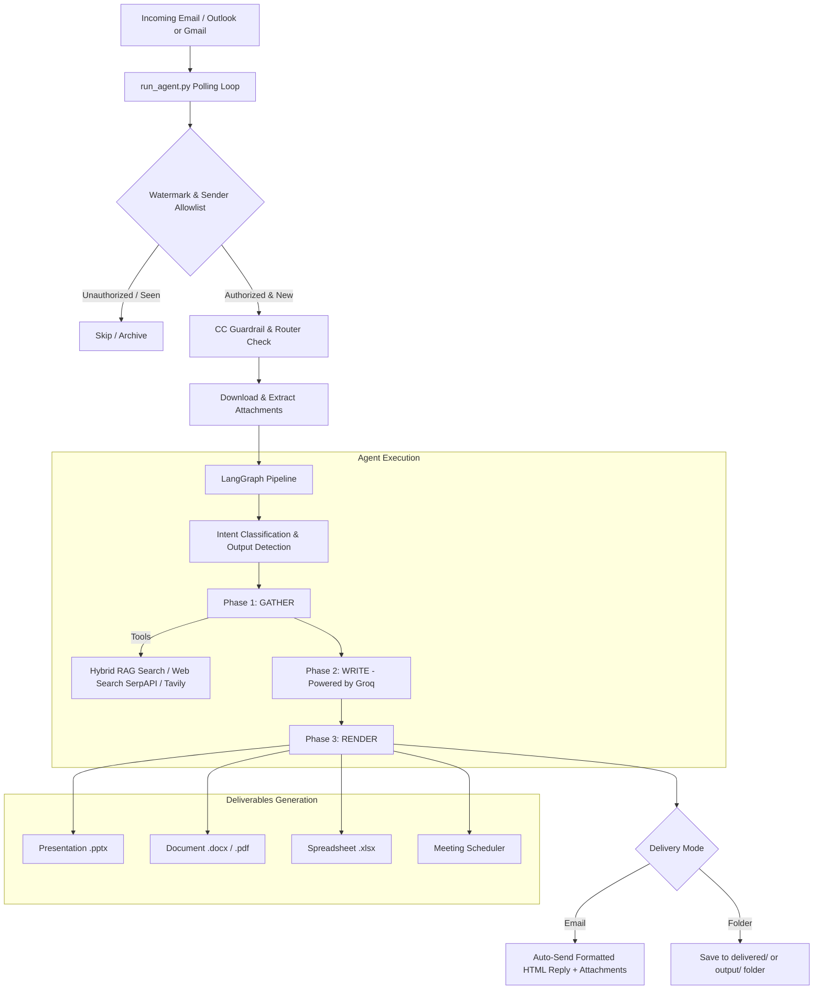

# ⚡ PhantomOps (Optimised RAG Edition)
### Autonomous Enterprise AI Operations Agent & Executive Email Copilot (Codename: *Sally*)

[](https://www.python.org/)
[](https://github.com/langchain-ai/langgraph)
[](https://groq.com/)
[](https://www.trychroma.com/)
[](https://learn.microsoft.com/en-us/graph/overview)
[](https://microsoft.com)

> **PhantomOps** is a production-grade, autonomous enterprise AI operations agent designed to live directly inside your corporate mailbox (Microsoft 365 / Outlook or Gmail). Powered by ultra-fast **Groq** inference and a robust **LangGraph** workflow engine, PhantomOps autonomously reads incoming emails and attachments, understands complex multi-step instructions, executes hybrid RAG search and web research, creates polished corporate deliverables (PowerPoint presentations, Word/PDF reports, Excel models with formulas), schedules calendar meetings, and replies or delivers files automatically.

---

## 📑 Table of Contents
1. [Overview](#-overview)
2. [Key Capabilities](#-key-capabilities)
3. [Architecture & Pipeline](#-architecture--pipeline)
4. [Optimised RAG Knowledge Base](#-optimised-rag-knowledge-base)
5. [Repository & Directory Structure](#-repository--directory-structure)
6. [Getting Started & Installation](#-getting-started--installation)
7. [Groq & LLM Configuration](#-groq--llm-configuration)
8. [Configuration & Customization (`agent_config.yaml`)](#-configuration--customization)
9. [Operator UI & Control Center](#-operator-ui--control-center)
10. [Security & Best Practices](#-security--best-practices)

---

## 🌟 Overview

Unlike interactive chatbots, **PhantomOps** functions as an autonomous executive operations coworker:
- **Zero-Friction Email Channel**: Interacts through standard corporate email threads—no custom dashboard or chat UI needed for end users.
- **Intelligent Triage & Guardrails**: Distinguishes between being directly addressed vs. merely CC'd; never spams threads; remembers multi-turn context; prevents duplicates with database-level lease locks.
- **Enterprise Office Deliverables**: Creates native `.pptx` slide decks from corporate templates, formatted `.docx`/`.pdf` documents, `.xlsx` spreadsheets with calculated formulas, and fills complex RFP/Q&A questionnaires.
- **Optimised Hybrid RAG**: Grounded in company documents and policies using ChromaDB vector retrieval + BM25 keyword search fused via Reciprocal Rank Fusion (RRF).
- **Ultra-Fast Groq Inference**: Native integration with Groq for near-instant responses and document generation.
- **100% Native Windows Setup**: Runs out-of-the-box on Windows 10/11 with 1-click batch scripts (`install.bat`, `start.bat`, `settings.bat`), requiring no Docker containers.

---

## 🚀 Key Capabilities

### 1. Autonomous Mailbox Ingestion & Triage
- **Dual Mailbox Support**: Microsoft 365 (Outlook) via Microsoft Graph API or Gmail via Google OAuth.
- **Downtime-Safe Watermarking**: Tracks a persistent watermark (`last_email_ts` in SQLite). Emails received while offline are processed upon restart.
- **Thread & CC Guardrails**:
  - If CC'd on an email, the agent stays silent unless explicitly addressed by name.
  - When replying, all original CC/To participants are preserved to maintain email thread integrity.
- **Multi-Agent Mailbox Routing**: Multiple agents (e.g., Sally and Claude) can share a single mailbox. An LLM router (`email_router.py`) sorts inbound mail into dedicated folders or skips unaddressed emails.
- **Anti-Spam & Deduplication**: State-tracked deduplication with cross-process SQLite lease claims (`phantomops.db`).

### 2. Multi-Format Document Ingestion & Vision
- **Broad File Support**: Native extraction for PDF (`pdfplumber` + `PyMuPDF`), Word (`python-docx`), PowerPoint (`python-pptx`), Excel/CSV (`pandas` + `openpyxl`), plain text, and Markdown.
- **Tesseract OCR Integration**: Automatically parses scanned documents and image-only PDFs (English and Arabic `eng+ara`).
- **Vision Image Tagging**: Inspects corporate logos and slide templates with vision models to auto-tag and organize design assets.

### 3. Automated Executive Deliverables
- **Presentations (`.pptx`)**: Generates structured, styled multi-slide presentations using corporate color palettes, custom layouts, and automated visual QA review (`ppt_creator.py`, `ppt_reviewer.py`).
- **Documents & Reports (`.docx` / `.pdf`)**: Generates corporate-styled reports, proposals, and briefings with automated PDF conversion.
- **Financial & Data Spreadsheets (`.xlsx`)**: Creates structured workbooks with styled headers, custom number formatting, and dynamic formulas (`excel_creator.py`).
- **RFP & Q&A Filling**: Automatically parses incoming questionnaires/RFPs and fills in grounded, accurate responses (`qa_filler.py`).
- **File Format Conversions**: Rapid format conversion between document types (`converter_tool.py`).

### 4. Calendar & Meeting Scheduling
- Natural language meeting booking: *"Schedule a 30-min meeting with client@example.com next Tuesday at 2 PM to review the proposal."*
- Extracts participants, subject, date, and exact times, creating verified calendar invites without guessing missing parameters.

---

## 🏗 Architecture & Pipeline



---

## 🧠 Optimised RAG Knowledge Base

The repository features an **Optimised RAG Engine** (`version/rag/` and `version/tools/rag_search.py`), engineered for enterprise accuracy:

| Feature | Technical Implementation |
|---|---|
| **Hybrid Search** | Combines **Dense Vector Retrieval** (ChromaDB) with **Lexical Keyword Retrieval** (BM25) fused via **Reciprocal Rank Fusion (RRF, k=60)**. |
| **Structure-Aware Chunking** | Splits text respecting markdown headings, numbered legal sections, bullet lists, page boundaries, and tabular structures (`chunking.py`). |
| **Agentic Tool Access** | LLM calls `search_knowledge_base(query)` iteratively within the **GATHER** loop for distinct lookups (e.g., policy vs. pricing), parallel to web search. |
| **Local Privacy-First Embeddings** | Runs local multilingual embeddings via Ollama (`bge-m3`), keeping sensitive internal company knowledge completely on-premise. |
| **Smart Ingestion Channels** | Ingests documents via: (1) dropping files into `intake/`, (2) email commands (*"Save this attachment to RAG"*), or (3) web URLs. |
| **Relevance Floor Cutoff** | Native English/Arabic stopword filtering and relevance floor score (`RAG_MIN_SCORE = 0.5`) to eliminate false-positive matches. |

---

## 📂 Repository & Directory Structure

```plaintext
phantomops_rag_optimised/
├── .gitignore                          # Git rules protecting secrets, venv, databases, and logs
├── README.md                           # Comprehensive project documentation
├── .venv/                              # Local Python virtual environment (ignored by Git)
├── database/                           # Shared persistent storage
│   ├── phantomops.db                   # Central SQLite DB (tasks, messages, config, drafts)
│   └── chroma_db/                      # ChromaDB persistent vector database
├── delivered/                          # Output destination for folder-delivery requests
├── intake/                             # Drop-point for auto-ingested files and documents
├── output/                             # Generated attachments, inbox temp files, logs
│   ├── inbox/                          # Staged inbound attachments
│   ├── logs/                           # System and execution logs
│   ├── ppts/                           # Generated PowerPoint decks
│   └── proposals/                      # Generated Word/PDF proposals
│
└── version/                            # Main PhantomOps Core Application (v4)
    ├── install.bat                     # 1-click Windows installer (Python, deps, helpers)
    ├── start.bat                       # Starts the autonomous email polling agent
    ├── settings.bat                    # Launches Streamlit Settings Control Center
    ├── agent_config.yaml               # Live runtime settings (Groq pinned, allowlist, branding)
    ├── .env.example                    # Template environment variables
    ├── requirements.txt                # Python package dependencies
    ├── run_agent.py                    # Main agent execution loop and email listener
    │
    ├── assets/                         # Corporate templates, logos, letterheads, and images
    │   ├── index.json                  # Auto-indexed asset catalog and visual metadata
    │   ├── letterhead/                 # Corporate letterheads (.docx)
    │   ├── logo/                       # Brand logos (.svg, .jpg)
    │   └── templates/                  # PowerPoint slide master templates (.pptx)
    │
    ├── agents/                         # Agent orchestration & prompts
    │   ├── assistant_agent.py          # Primary executor: GATHER -> WRITE -> RENDER
    │   ├── email_router.py             # Mailbox multi-agent routing
    │   ├── supervisor.py               # Task router & supervisor
    │   └── prompts/                    # Specialized system prompt templates
    │
    ├── core/                           # System core
    │   ├── config.py                   # Central configuration & path discovery
    │   ├── master_graph.py             # LangGraph state machine definition
    │   └── database/sqlite_db.py       # Thread-safe SQLite database manager
    │
    ├── rag/                            # Optimised RAG Engine
    │   ├── chunking.py                 # Structure-aware heading/table chunker
    │   ├── embedding.py                # Ollama / bge-m3 embeddings interface
    │   ├── ingestion.py                # Multi-format document parser & indexing
    │   ├── search.py                   # Hybrid BM25 + Vector RRF search
    │   └── store.py                    # ChromaDB persistent storage & hashing
    │
    ├── tools/                          # Actionable tools
    │   ├── doc_creator.py              # Word (.docx) and PDF document generator
    │   ├── ppt_creator.py              # Styled PowerPoint presentation creator
    │   ├── ppt_reviewer.py             # Slide layout & contrast automated QA
    │   ├── excel_creator.py            # Excel model & calculation engine
    │   ├── file_reader.py              # Multi-format reader + OCR extractor
    │   ├── meeting_scheduler.py        # Calendar event creation & invites
    │   ├── qa_filler.py                # RFP & questionnaire automated answering
    │   ├── rag_search.py               # LLM tool wrapper for hybrid KB search
    │   └── web_search.py               # SerpAPI & Tavily web research tools
    │
    ├── skills/email_skill/             # Email connectivity (Outlook Graph & Gmail)
    ├── Outlook-Connector/              # One-click OAuth authentication for Outlook
    ├── Gmail-Connector/                # One-click OAuth authentication for Gmail
    └── ui/                             # Web management interfaces
        ├── settings_app.py             # Streamlit Settings Control Center
        └── dashboard.py                # Streamlit Operations & Audit Dashboard
```

---

## 🛠 Getting Started & Installation

### Prerequisites
- **Operating System**: Windows 10 or 11 (64-bit).
- **Python**: Version 3.11 (installed automatically by `install.bat` via `winget` if missing).
- **Optional Tools**:
  - **LibreOffice**: Recommended for direct DOCX to PDF conversion.
  - **Tesseract OCR**: Recommended for scanned / image-based PDF text extraction.
  - **Ollama**: Recommended if using local RAG embeddings (`bge-m3`).

### Step-by-Step Setup

#### 1. Run Installer
In the `version/` directory, double-click **`install.bat`**:
- Sets up the `.venv` virtual environment.
- Installs all dependencies from `requirements.txt`.
- Optionally installs LibreOffice and Tesseract if selected.

#### 2. Configure Environment (`version/.env`)
Copy `version/.env.example` to `version/.env` (or edit existing `version/.env`):
```env
# ── Primary LLM API Key (Groq) ───────────────────────────────────────────
GROQ_API_KEY="gsk_your_groq_api_key_here"

# ── Optional Search APIs (for live web research) ─────────────────────────
TAVILY_API_KEY="tvly-..."
SERPAPI_KEY="..."

# ── Outlook Configuration (Microsoft 365 Azure App) ──────────────────────
OUTLOOK_CLIENT_ID="your-client-id"
OUTLOOK_CLIENT_SECRET="your-client-secret"
OUTLOOK_TENANT_ID="your-tenant-id"
```

#### 3. Authenticate Mailbox
- **Outlook**: Double-click `version/Outlook-Connector/run.bat` (or let `start.bat` launch sign-in). Log in with the agent's Microsoft account to generate `version/outlook_token.txt`.
- **Gmail**: Run `version/Gmail-Connector/run.bat` if configured for Gmail.

#### 4. Launch the Agent
Double-click **`version/start.bat`**.
The console verifies mailbox credentials, checks SQLite database status, and begins monitoring:
```plaintext
============================================================
  PhantomOps Email Agent - Starting
============================================================
[EMAIL] Provider: Outlook
[INIT] Database verified: database/phantomops.db
[CONFIG] Active LLM Engine: Groq
[POLL] Polling mailbox every 15s...
```

---

## ⚡ Groq & LLM Configuration

PhantomOps is configured to use **Groq** for high-speed LLM generation:

- **Configured in `version/agent_config.yaml`**:
  ```yaml
  agent_model: groq
  provider_models:
    groq: openai/gpt-oss-120b    # High-capacity open architecture
    # Alternative: qwen/qwen3.8-27b | allam-2-7b
  ```
- **Built-in Rate-Limit Recovery**: Includes exponential backoff with jitter and automated context-trimming retry loops to handle Token-Per-Minute (TPM) limits gracefully.

---

## ⚙️ Configuration & Customization (`agent_config.yaml`)

Operator settings live in **`version/agent_config.yaml`**. 

> 💡 **Hot Reload**: Changes to `agent_config.yaml` take effect on the **very next incoming email** without restarting the agent (except for changing `email_provider`).

```yaml
# Agent Persona & Name
agent_name: "Sally"

# Company Branding (Used in email signatures, PPT title slides, doc headers)
company:
  name: "EAI Systems Pvt. Ltd."
  short: "EAI SYSTEMS"
  email: "info@eaisystems.com"
  web: "www.eaisystems.com"

# Primary LLM Provider
agent_model: groq

# Email Provider ("outlook" or "gmail")
email_provider: outlook

# Authorized Senders (Emails from other senders are silently ignored)
sender_allowlist:
  - "executive@yourcompany.com"
  - "manager@yourcompany.com"

# Presentation settings
ppt_include_logo: true
```

---

## 🖥 Operator UI & Control Center

PhantomOps includes dedicated Streamlit interfaces for operators:

1. **Settings Control Center**:
   - Double-click `version/settings.bat` (or run `streamlit run version/ui/settings_app.py`).
   - Password-protected UI to live-edit models, company branding, sender allowlists, and mailbox authentication tokens.
2. **Operations & Audit Dashboard**:
   - Run `streamlit run version/ui/dashboard.py`.
   - Inspect historical email threads, audit logs, generated deliverables, and task performance metrics.

---

## 🔒 Security & Best Practices

- **Secrets Kept Local**: `.env`, OAuth tokens (`outlook_token.txt`, `token.json`), SQLite databases, and logs are strictly ignored by `.gitignore` and never committed to version control.
- **Enforce Sender Allowlist**: Maintain `sender_allowlist` restricted to authorized company employees to prevent unauthorized agent triggering.
- **On-Premise Embeddings**: Internal company knowledge remains secure and private on your machine when using local embeddings.
