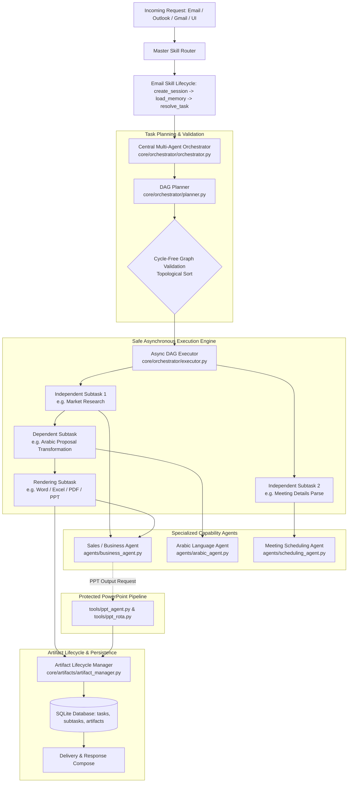

# PhantomOps Multi-Agent Architecture Guide

**System:** PhantomOps Autonomous Multi-Agent Operations System  
**Lead AI Systems Architect:** Antigravity  
**Updated:** October 30, 2026  

---

## 1. Architectural Overview

PhantomOps coordinates autonomous specialized capabilities under a central asynchronous orchestrator. The architecture decouples intention routing, task dependency DAG planning, concurrent execution, and format-specific deliverable rendering.

---

## 2. Core Subsystems

### 2.1 Central Orchestrator & Task Plan DAG
* **`core/orchestrator/task_plan.py`**: Typed data representations of `Subtask` and `TaskPlan`. Enforces states:
  `PENDING`, `READY`, `RUNNING`, `SUCCEEDED`, `FAILED`, `RETRY_WAIT`, `CANCELLED`, `BLOCKED`.
  Validates dependency graphs using cycle detection (DFS 3-color marking); rejects cyclic plans with `ValueError`.
* **`core/orchestrator/executor.py`**: Coordinates concurrent execution using a bounded `ThreadPoolExecutor(max_workers=max_concurrency)`. Identifies independent subtasks whose prerequisite dependencies have succeeded. Applies timeouts and bounded retries with exponential backoff (`delay * 2^(attempt-1)`) only to idempotent actions (`research`, `draft_proposal`, `render_deliverable`). Non-idempotent actions (`calendar_booking`, `send_email`) are guarded against duplicate execution.
* **`core/orchestrator/planner.py`**: Maps high-level requests into dependency-ordered DAGs:
  - Scenario A (Business Request): `research` $\to$ `draft_proposal` $\to$ `render_deliverable`
  - Scenario B (Arabic Sales Proposal): `research` $\to$ `draft_proposal` $\to$ `arabic_translation` $\to$ `render_deliverable`
  - Scenario C (Research + Meeting): `research` and `meeting_scheduling` run concurrently in parallel; `synthesis` waits for both.

### 2.2 Specialized Capabilities
1. **Sales & Business Agent (`agents/business_agent.py`)**:
   - Gathers intelligence using Tavily / SerpAPI web search and ChromaDB RAG.
   - Drafts executive summaries and structured proposals with milestone tables.
   - Generates `.docx` and `.pdf` via `tools/doc_creator.py` and `.xlsx` via `tools/excel_creator.py`.
   - Delegates presentation requests strictly to the protected PPT pipeline.
2. **Arabic Language Agent (`agents/arabic_agent.py`)**:
   - Specializes in translation and localization into Modern Standard Arabic (Fusha).
   - Preserves proper nouns, numbers, currency values, dates, and milestone tables.
   - Operates as a pipeline transformation/review stage or standalone translation handler.
   - Conducts linguistic validation and RTL verification.
3. **Meeting Scheduling Agent (`agents/scheduling_agent.py`)**:
   - Provider abstraction: `CalendarProvider` with `LiveCalendarProvider` and `MockCalendarProvider`.
   - Extracts purpose, attendees, proposed date/time, duration.
   - Restricts invitations to internal corporate domains (`filter_attendees_by_domain`).
   - Returns `needs_info` if critical details are missing rather than fabricating meetings.
   - Proposes draft invitations (`draft_proposal`) requiring explicit user confirmation before booking.

### 2.3 Protected PowerPoint Pipeline (FROZEN)
* `tools/ppt_agent.py`, `tools/ppt_creator.py`, `tools/ppt_reviewer.py`, `tools/marp_creator.py`, `tools/ppt_rota.py` are preserved intact.
* Dynamic 10-theme sequential rota and atomic disk tracking (`database/ppt_rota_state.json`) remain fully operational.

### 2.4 Artifact Lifecycle & Delivery Guard
* **`core/artifacts/artifact_manager.py`**:
  - Verifies that files exist and are non-empty (> 0 bytes) before marking success.
  - Computes SHA-256 integrity hashes.
  - Persists records to the SQLite `artifacts` table.
  - Guards against duplicate delivery on retries (`is_already_delivered`).

### 2.5 Thread Isolation & Concurrency Safety
* Web search tool caches (`_LAST_SEARCH_URLS`, `_LAST_PAGE_TEXT`) are isolated using Python `threading.local()` to prevent cross-task race conditions during parallel subtask execution.
* Excel cell values are sanitized against CSV/Excel formula injection (`=cmd...`).
