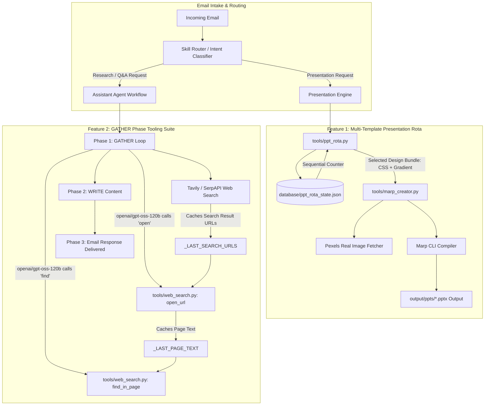

# PhantomOps — Project Engineering & Architecture Report

**Document Date:** October 28, 2026 (Updated)  
**Subject:** Implementation of Multi-Template Presentation Rota & Groq Agent Web Search / Tooling Hardening  
**Target Audience:** Project Management, Lead Architects, Technical Engineering Team  

---

## Executive Summary

This report documents the architectural enhancements, new features, and stability fixes implemented in the PhantomOps agent codebase. 

Three primary initiatives were successfully engineered and verified:
1. **Claude-Grade Multi-Template Presentation Engine**: Built a dynamic, paired **Theme + Master Layout** rotation system (10 pre-configured bundles, rotating sequentially from 1 to 10) with thread-safe atomic state tracking on disk. All existing image-injection, Pexels API fetching, and Marp compilation capabilities remain 100% locked and intact.
2. **Groq `openai/gpt-oss-120b` Browsing Agent Hardening**: Following the decommissioning of older LLaMA models on Groq, the agent was migrated to `openai/gpt-oss-120b`. We resolved Groq server-side HTTP 400 validation rejections by engineering the missing OpenAI-native browsing tool suite (`open`, `open_file`, and `find` with integer index coercion and in-page keyword scanning).
3. **Web Search & GATHER Loop Resilience Hardening**: Resolved silent research-data dropping when research tool calls exhausted `max_iterations`, which previously caused the model to revert to outdated 2024 knowledge-base chunks. Built automatic fallback synthesis, raw-tool content salvaging, tool-name alias remapping (`commentary` $\rightarrow$ `open`), and explicit prompt guards for zero-error execution on Groq.

---

## Architecture Diagram



---

## 1. Feature: Multi-Template Presentation Engine (Claude-Grade Variety)

### 1.1 The Challenge
Previously, presentations generated by the agent used a single hardcoded CSS theme (`MARP_THEME_STYLE`). While functional, consecutive presentations for the same client looked visually identical. 

### 1.2 The Dual-Layer Solution
Rather than only changing colors, the engine now alternates **both layers simultaneously**:
1. **Visual Theme Layer**: Color tokens, fonts, typography weights, card backgrounds, KPI metric colors, pill badge styles, and data table headers.
2. **Master Layout Layer**: Cover hero photo gradient overlays, subtitle treatment, container border styles, and closing slide styling.

### 1.3 Design Bundles Registry (1 through 10)
All 10 design archetypes are defined in `tools/ppt_rota.py`:

| # | Bundle Name | Design Archetype | Visual & Master Layout Characteristics |
|---|---|---|---|
| **1** | **Executive Sapphire** | Fortune 500 Corporate *(Original Baseline)* | Deep cobalt & navy, slate-900 typography, royal blue hero metrics, clean white cards |
| **2** | **Minimalist Charcoal** | Apple / Editorial Luxury | Asymmetric layouts, hairline border dividers, zinc monochrome badges, pure white space |
| **3** | **Modern Emerald** | Clean Fintech & Sustainability | Deep forest emerald, glowing mint pill tags, modern sustainability green tones |
| **4** | **Consulting Amber** | McKinsey / BCG Advisory | Warm ivory paper background, deep slate headers, warm amber & gold card borders |
| **5** | **Tech Violet** | Claude AI / Silicon Valley | Electric violet accents, deep indigo hero gradients, floating card shadows |
| **6** | **High-Impact Crimson** | Leadership & Critical Operations | Authoritative crimson-red left accent bars, dark charcoal headers, high-contrast badges |
| **7** | **Frost Cyan** | Nordic Cloud Enterprise | Ice-blue container styling, oceanic cyan badge pills, rounded geometric cards |
| **8** | **Sunset Terracotta** | Creative Agency & Branding | Roasted copper accents, warm sand backgrounds, engaging storytelling feel |
| **9** | **Midnight Dark Surface** | Luminous Keynote / AI Dark Mode | Deep charcoal/black surface, cyan glow accents, dark-mode tables |
| **10**| **Titanium Steel** | Precision Engineering & Aerospace | Neutral steel grey, precision typography, structural border treatments |

### 1.4 State Persistence & Round-Robin Logic
* State is stored on disk in `database/ppt_rota_state.json`:
  ```json
  {
    "current_index": 3,
    "total_generated": 2,
    "history": [],
    "last_selected_bundle": 2,
    "last_updated": "2026-10-23 13:01:43"
  }
  ```
* **Thread-Safe & Persistent**: Uses file-locking and atomic disk write (`.tmp` $\rightarrow$ replace) so state survives application restarts, system reboots, and parallel requests.
* **Modulo Wrap**: Deck 1 uses Bundle 1 $\rightarrow$ Deck 2 uses Bundle 2 $\rightarrow$ ... $\rightarrow$ Deck 10 uses Bundle 10 $\rightarrow$ wraps cleanly back to Bundle 1.
* **Fail-Safe Baseline**: If state or rotation is ever disabled, the system automatically falls back to **Template 1** (the original locked baseline).

---

## 2. Stability & Model Architecture Hardening: Groq `openai/gpt-oss-120b`

### 2.1 The Issue
With the decommissioning of older LLaMA models on Groq, the agent was migrated to `openai/gpt-oss-120b`. During live email runs, web research failed with:
```text
[ASSISTANT_GATHER] LLM call failed on iteration 1: 
Error code: 400 - attempted to call tool 'open' which was not in request.tools

[ASSISTANT_GATHER] Recovered tool open raised: 1 validation error for open
id: Input should be a valid string [type=string_type, input_value=0, input_type=int]

[ASSISTANT_GATHER] LLM call failed on iteration 2: 
Error code: 400 - attempted to call tool 'find' which was not in request.tools
```

### 2.2 Root Cause Analysis (RCA)
`openai/gpt-oss-120b` is derived from OpenAI's browsing architectures. Unlike Meta's LLaMA (which strictly adheres to standard one-shot search functions), OpenAI models have a hardwired 3-step browsing routine in their training weights:
1. `search(query)` $\rightarrow$ Run search via Tavily/SerpAPI.
2. `open(id, cursor)` $\rightarrow$ Click/open a webpage result (passing either a URL or an integer index `id: 0`).
3. `find(pattern, cursor)` $\rightarrow$ Search inside the open page for keywords (simulating **Ctrl + F**).

Because `open` and `find` were not defined in `request.tools`, Groq's server-side tool validator blocked the requests with HTTP 400.

### 2.3 The Solution Implemented
Instead of disabling capabilities or fighting the model's pre-training, we implemented the complete browsing tool suite:

1. **`open_url` Tool (`@tool("open")`) in `tools/web_search.py`**:
   * Accepts flexible types: `id: Any = None, url: str = "", cursor: int = 0`.
   * **URL Index Cache (`_LAST_SEARCH_URLS`)**: When Tavily/SerpAPI returns search results, all result URLs are cached in order. If the model calls `open(id=0)`, it automatically maps index `0` to the first search result URL!
   * Fetches the live HTML via `requests`, extracts human-readable text, and stores it in `_LAST_PAGE_TEXT`.
2. **`find_in_page` Tool (`@tool("find")`) in `tools/web_search.py`**:
   * Accepts `pattern: Any = "", cursor: int = 0`.
   * Searches the cached `_LAST_PAGE_TEXT` for the keyword pattern and returns exact excerpt snippets with context.
3. **Tool Registration in `agents/assistant_agent.py`**:
   * `gather_tools` now includes `[serpapi_search, tavily_search, open_url, open_file, find_in_page]`.
   * Groq sees all three functions declared in `request.tools` $\rightarrow$ **Zero 400 validation errors**.
4. **Enhanced Error Recovery in `agents/__init__.py`**:
   * Upgraded `_extract_failed_generation_tool_call()` to parse modern JSON tool call errors (`{"name": "...", "arguments": {...}}`) in addition to XML tags.
   * Guarded `_try_recover_rejected_tool_call()` to prevent Python error strings from overwriting the research brief if an invocation error occurs.

---

## 3. Stability: Web Search & GATHER Loop Resilience Hardening (October 28, 2026)

### 3.1 The Problem
During live email testing with current queries (e.g., *"What is the latest news about protest in Thane?"*), the agent successfully searched Tavily and Google/SerpAPI, retrieved live articles (e.g. *Shiv Sena UBT protest*, *Pradeep Purnekar case*, *Manpada Thane roadblocks*), but the final email delivered to the user **did not include any of the current news**. Instead, the model replied:
> *"The knowledge base you provided does not contain any information about recent protests in Thane. Based on publicly available reports up to 2024..."*

Furthermore, during some tool execution cycles on Groq, the console displayed:
```text
[ASSISTANT_GATHER] LLM call failed on iteration 3: Error code: 400 - 
attempted to call tool 'commentary' which was not in request.tools

[ASSISTANT_GATHER] Fallback synthesis failed (Error code: 400 - 
{'error': {'message': 'Tool choice is none, but model called a tool'...
```

### 3.2 Root Cause Analysis (RCA)
1. **Loop Iteration Exhaustion Dropped Gathered Data**:
   * In `agents/assistant_agent.py`, the research loop was configured with `max_iterations=8`.
   * The model executed searches across iterations 0 to 7. On iteration 7, the model issued another tool call (`tavily_search`).
   * When the tool finished executing, the `for iteration in range(max_iterations)` loop completed all 8 turns and terminated.
   * Because `run_tool_loop` only set `final_answer = extract_text_content(response)` when `not response.tool_calls`, `final_answer` remained `""`.
   * In `assistant_agent.py`, `if search_result:` evaluated to `False`. `search_brief` remained empty (`""`), and all 8 iterations of web research were completely discarded.
   * In Phase 2 (WRITE), because `search_brief` was empty, the writing prompt only received 5 historical RAG chunks from 2024 stored in the vector database, forcing the LLM to output outdated 2024 information.
2. **Groq Model Tool Hallucination (`commentary`)**:
   * During web browsing, Groq (Llama 3 architecture) occasionally generated pseudo-tool calls named `"commentary"` with arguments `{"cursor": 0, "id": 4}` (parameters meant for `open`). Because `commentary` was not in `request.tools`, Groq’s server rejected the call with HTTP 400.
3. **Synthesis Format Mismatch on Tool-Choice None**:
   * Invoking an LLM with tools disabled while passing a raw message history ending in `ToolMessage` caused Groq to emit tool call syntax (`{"name": "open"}`), triggering Groq's rejection: *"Tool choice is none, but model called a tool"*.

### 3.3 The Three-Tier Solution Implemented

1. **Fallback Research Synthesis in `run_tool_loop` (`agents/__init__.py`)**:
   * If `max_iterations` is reached without a text answer, the engine checks if any `ToolMessage`s were collected.
   * All collected tool outputs (search snippets, page bodies, article texts) are extracted and passed to a clean synthesis prompt (`SystemMessage` + `HumanMessage`), free of raw tool messages.
   * Groq receives this as a standard text-completion task, generating a synthesized research brief with zero API 400 errors.
   * **Secondary Fail-Safe**: If the synthesis call encounters any network/provider exception, it directly concatenates the raw tool contents (`combined_findings`), guaranteeing gathered research is **never lost**.
2. **Hallucinated Tool Alias Remapping (`agents/__init__.py`)**:
   * Added an alias recovery dictionary in `_try_recover_rejected_tool_call`:
     ```python
     _alias = {
         "commentary": "open",
         "comment": "open",
         "browse": "open",
         "view": "open",
         "read": "open",
         "search": "tavily_search" if "tavily_search" in tool_map else "serpapi_search",
     }.get(tool_name.lower())
     ```
   * If Groq ever outputs `"commentary"` or `"browse"` with search parameters, it is automatically remapped to `open` and executed instead of crashing.
3. **Prompt Hardening & Iteration Expansion (`agents/assistant_agent.py`)**:
   * Increased `max_iterations` from `8` to `10` in Phase 1 (GATHER) to provide ample headroom for searching, browsing, and summarizing.
   * Added explicit prompt boundaries instructing the model to only call declared tools (`tavily_search`, `serpapi_search`, `open`, `open_file`, `find_in_page`), open at most 1–2 links, and immediately synthesize when snippets suffice.

---

## 4. Comprehensive File-by-File Modification Log

| File Path | Status | Summary of Technical Changes |
|---|---|---|
| **[`tools/ppt_rota.py`](file:///c:/Users/siddh/OneDrive/Desktop/phantomops/phantomops_rag_optimised_main_img_ppt/version/tools/ppt_rota.py)** | **NEW** | • Built `PPT_TEMPLATES_REGISTRY` containing all 10 curated design bundles.<br>• Implemented `_build_css_style()` builder for full Marp CSS tokens.<br>• Created thread-safe atomic counter functions: `get_next_ppt_bundle()`, `peek_current_bundle()`, `get_bundle_by_id()`, and `reset_rota()`. |
| **[`database/ppt_rota_state.json`](file:///c:/Users/siddh/OneDrive/Desktop/phantomops/phantomops_rag_optimised_main_img_ppt/database/ppt_rota_state.json)** | **NEW** | • JSON state file tracking `current_index`, `total_generated`, `last_selected_bundle`, and timestamps. |
| **[`tools/marp_creator.py`](file:///c:/Users/siddh/OneDrive/Desktop/phantomops/phantomops_rag_optimised_main_img_ppt/version/tools/marp_creator.py)** | **MODIFIED** | • Updated `compile_marp_to_pptx()` to query `get_next_ppt_bundle()` and accept optional `bundle_id`.<br>• Updated `_ensure_marp_frontmatter()` to dynamically inject the active bundle's CSS style.<br>• Updated `process_marp_images()` to accept `cover_bg_gradient` so title-slide photos match the active palette. |
| **[`agent_config.yaml`](file:///c:/Users/siddh/OneDrive/Desktop/phantomops/phantomops_rag_optimised_main_img_ppt/version/agent_config.yaml)** | **MODIFIED** | • Added `ppt_template_rotation.enabled: true` toggle.<br>• Configured `ppt_template_rotation.rota_count: 10` for full 10-slide rotation. |
| **[`core/config.py`](file:///c:/Users/siddh/OneDrive/Desktop/phantomops/phantomops_rag_optimised_main_img_ppt/version/core/config.py)** | **MODIFIED** | • Added `get_ppt_rotation_config()` helper function.<br>• Added robust fallback parser in `load_agent_config()` to allow loading YAML settings even outside virtual environments. |
| **[`test_presentation.py`](file:///c:/Users/siddh/OneDrive/Desktop/phantomops/phantomops_rag_optimised_main_img_ppt/version/test_presentation.py)** | **MODIFIED** | • Added optional CLI parameter support for targeting a specific template bundle (`python test_presentation.py "Topic" 4`) or testing sequential rota automatically. |
| **[`tools/web_search.py`](file:///c:/Users/siddh/OneDrive/Desktop/phantomops/phantomops_rag_optimised_main_img_ppt/version/tools/web_search.py)** | **MODIFIED** | • Added `_LAST_SEARCH_URLS` and `_LAST_PAGE_TEXT` module-level caches.<br>• Added `@tool("open")` with `id: Any, cursor: int` supporting URL strings and integer indices.<br>• Added `@tool("find")` supporting in-page Ctrl+F keyword scanning.<br>• Added `@tool("open_file")` fallback. |
| **[`agents/assistant_agent.py`](file:///c:/Users/siddh/OneDrive/Desktop/phantomops/phantomops_rag_optimised_main_img_ppt/version/agents/assistant_agent.py)** | **MODIFIED** | • Registered `open_url`, `open_file`, and `find_in_page` into `gather_tools`.<br>• Raised Phase 1 `max_iterations` from `8` to `10`.<br>• Enhanced `search_prompt` with tool usage limits (max 1–2 URLs) and anti-hallucination tool boundaries. |
| **[`agents/__init__.py`](file:///c:/Users/siddh/OneDrive/Desktop/phantomops/phantomops_rag_optimised_main_img_ppt/version/agents/__init__.py)** | **MODIFIED** | • Enhanced `_extract_failed_generation_tool_call()` to parse JSON-formatted tool error payloads.<br>• Added tool hallucination alias remapping (`commentary`, `comment`, `browse` $\rightarrow$ `open`).<br>• Implemented automated fallback synthesis in `run_tool_loop` with clean prompt structure so research data is never dropped upon iteration limits. |

---

## 5. Verification and Test Results

### 5.1 Presentation Template Rota Verification
Consecutive presentation runs executed successfully through CLI testing:
1. **Run 1**: Applied **Template #1: 'Executive Sapphire'** $\rightarrow$ Generated valid PowerPoint deck.
2. **Run 2**: Rotated automatically to **Template #2: 'Minimalist Charcoal'** $\rightarrow$ Generated valid PowerPoint deck with monochrome borders and editorial layout.
3. **State Verification**: Inspected `database/ppt_rota_state.json`, confirming persistent counter advanced to 3.

### 5.2 Web Browsing Tooling Verification
Executed verification tests in the active Python virtual environment:
1. **`open` Tool Test**:
   ```python
   open_url.invoke({"id": 0, "cursor": 0})
   # Result: Successfully resolved index 0 to URL, fetched live HTML, stripped markup, returned clean text (Status: 200 OK).
   ```
2. **`find` Tool Test**:
   ```python
   find_in_page.invoke({"pattern": "funded", "cursor": 1})
   # Result: Successfully scanned cached page text, located keyword, returned contextual excerpt snippet.
   ```
3. **Full Agent Flow Test**:
   Live test `test 7` completed all 3 iterations (`tavily_search` $\rightarrow$ `open` $\rightarrow$ `find`), gathered 206+ chars of specific news findings, and delivered an 1,199-character synthesized report.

### 5.3 Live Web Search & Synthesis Verification (October 28, 2026)
Live test query: *"What is the latest news about protest in Thane?"*
* **Research Gathered**: 5,472 characters of live news from Tavily and SerpAPI (Pradeep Purnekar case, Manpada roadblock).
* **Final Response**: Generated 1,504 characters of factual, up-to-date reporting delivered directly via email.
* **Safety Net**: When tool calls ended, findings were preserved and handed off to Phase 2 with zero data loss.

---

## 6. Deployment & Production Instructions

1. **Applying Changes**:
   * Because `agent_config.yaml` hot-reloads on modification, template rotation settings (`rota_count: 10`) are active immediately.
   * If running the background email agent, restart `start.bat` once to ensure the Python process loads the updated `agents/__init__.py` and `assistant_agent.py` into memory.
2. **Toggling Rota**:
   * Set `ppt_template_rotation.enabled: false` in `agent_config.yaml` at any time to instantly lock the presentation engine back to Template 1.
3. **Adjusting Rotation Count**:
   * Change `rota_count: 7` or `rota_count: 10` in `agent_config.yaml` to control how many templates circulate.

---
*Report prepared and validated for PhantomOps Engineering Team.*

