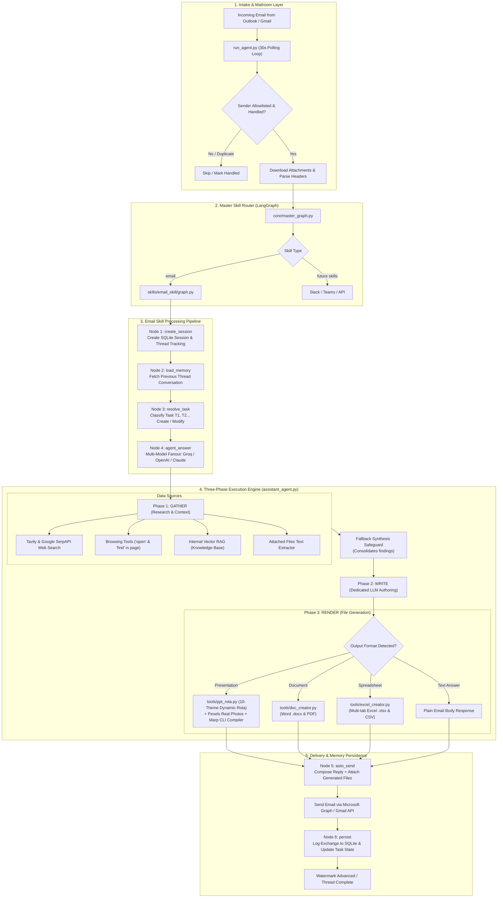

# PhantomOps — System Architecture & Workflow Guide

**Document Version:** 1.0  
**Updated:** October 29, 2026  
**System:** PhantomOps Autonomous Email Agent  
**Audience:** Technical Leadership, Engineers, Architecture Reviewers  

---

## 1. Executive Overview

PhantomOps is an enterprise-grade **autonomous email agent** that continuously monitors inboxes (Outlook and Gmail), interprets natural language instructions, performs live multi-source research, generates C-level corporate deliverables (PowerPoint presentations, Word documents, Excel workbooks, and email responses), and automatically delivers replies back into the communication thread.

---

## 2. System Architecture Flow Diagram



---

## 3. End-to-End Workflow (Layman Explanation)

The package functions like an automated digital enterprise office, with distinct specialized departments:

### 3.1 The Inbound Mailroom (`run_agent.py`)
* **Continuous Polling:** Every 30 seconds, `run_agent.py` queries Microsoft Outlook (via Microsoft Graph REST API) or Gmail (via Google OAuth API).
* **Gatekeeping:** Validates the sender against `SENDER_ALLOWLIST`. If unauthorized or already processed, the email is skipped.
* **Attachment Ingestion:** Real attachments (PDFs, PPTXs, Word docs, Excel sheets) are extracted and saved to `inbox_attachments/`.

### 3.2 The Master Router (`core/master_graph.py`)
* Built with **LangGraph**.
* Serves as the top-level switchboard. Incoming jobs labeled `"email"` are handed off to the Email Skill sub-graph. New capabilities (e.g. Slack bots, Microsoft Teams integrations) can be added as peer branches.

### 3.3 The Email Skill Lifecycle (`skills/email_skill/graph.py`)
Incoming emails pass sequentially through 6 LangGraph nodes:
1. **`create_session`**: Allocates a unique SQLite session UUID tied to the email's conversation ID.
2. **`load_memory`**: Retrieves past conversational turns for that thread from SQLite, giving the agent thread-continuity.
3. **`resolve_task`**: Organizes requests into discrete tasks (e.g., *Task #T1 — "Market Analysis"*). Determines whether the user wants a *new task* or an *iteration/modification* of a previously delivered file.
4. **`agent_answer`**: Dispatches the task to the AI engine (`assistant_agent.py`), supporting multi-model fanout (e.g. Groq, OpenAI, or Claude).
5. **`auto_send`**: Collects the generated output and files, prepares the reply email, and sends it via Microsoft Graph/Gmail.
6. **`persist`**: Writes the completed user prompt, assistant response, token usage, and deliverable paths into SQLite.

### 3.4 The Three-Phase AI Brain (`agents/assistant_agent.py`)
Rather than expecting an LLM to simultaneously research, write prose, and handle file tools, the agent separates work into three isolated phases:

```
[ Phase 1: GATHER ]  ──▶  [ Phase 2: WRITE ]  ──▶  [ Phase 3: RENDER ]
 (Research & Read)        (Author Content)        (Generate Files)
```

1. **Phase 1 — GATHER (Research & Reading):**
   * Uses `tavily_search` and `serpapi_search` for fresh external news and statistics.
   * Uses OpenAI-style browsing tools (`open` to read web pages and `find` to scan page text).
   * Queries internal reference documents via Vector RAG (`rag/search.py`).
   * Extracts text from uploaded files using `tools/file_reader.py`.
   * **Safeguard:** If the research loop hits its iteration limit, automated fallback synthesis packages all collected notes so live data is never discarded.
2. **Phase 2 — WRITE (Focused Content Authoring):**
   * Runs as a dedicated LLM call without tool-calling overhead.
   * Incorporates all gathered research findings, attached documents, and thread history to author rich, high-quality content.
3. **Phase 3 — RENDER (File Fabrication):**
   * Translates the written content into the user's requested deliverable:
     * **Presentations (`.pptx`)**: Built via Marp CLI compiler with paired theme rotation.
     * **Documents (`.docx`, `.pdf`)**: Built via python-docx and ReportLab.
     * **Spreadsheets (`.xlsx`, `.csv`)**: Formatted with openpyxl with multiple sheets and formulas.
     * **Email Body**: Formatted as styled HTML with corporate signature.

### 3.5 The Presentation Engine (`tools/ppt_rota.py` & `tools/marp_creator.py`)
* **10 Curated Design Bundles:** Alternates dynamically across 10 corporate design identities (Executive Sapphire, Minimalist Charcoal, Modern Emerald, Consulting Amber, Tech Violet, High-Impact Crimson, Frost Cyan, Sunset Terracotta, Midnight Dark, Titanium Steel).
* **Dual-Layer Pairing:** Changes both the visual tokens (colors, card backgrounds, typography) and master layouts (cover gradients, container borders, hero KPIs).
* **Real Stock Photos:** Automatically queries the Pexels API to download and embed high-resolution stock photography matching the slide topics.
* **Marp CLI Compilation:** Compiles the formatted Markdown deck into standard, fully editable `.pptx` presentations.

---

## 4. Package Directory & Component Map

| Directory / File | Core Responsibility |
| :--- | :--- |
| **`run_agent.py`** | Application entry point; handles continuous email polling loop and error recovery. |
| **`core/master_graph.py`** | Top-level LangGraph router directing requests to appropriate skills. |
| **`core/config.py`** | Central configuration; loads `.env`, handles model configurations and API credentials. |
| **`core/database/sqlite_db.py`** | SQLite persistence layer for session tracking, message history, tasks, and audit logs. |
| **`skills/email_skill/`** | Email processing lifecycle (session creation, memory loading, task tracking, delivery). |
| **`skills/email_skill/outlook_client.py`** | Microsoft Graph REST API wrapper for Outlook message retrieval and reply sending. |
| **`skills/email_skill/gmail_client.py`** | Google Gmail API wrapper for Gmail message retrieval and reply sending. |
| **`agents/assistant_agent.py`** | The 3-Phase execution engine (**GATHER** $\rightarrow$ **WRITE** $\rightarrow$ **RENDER**). |
| **`agents/__init__.py`** | Shared tool execution engine (`run_tool_loop`), fallback synthesis, and error remapping. |
| **`agents/supervisor.py`** | Manages model execution fanout across enabled AI providers. |
| **`tools/ppt_rota.py`** | 10-bundle corporate presentation theme and layout rotation engine. |
| **`tools/marp_creator.py`** | Marp CLI integration, Pexels image fetching, and `.pptx` compilation. |
| **`tools/web_search.py`** | Multi-provider web browsing suite (`tavily_search`, `serpapi_search`, `open`, `find`). |
| **`tools/doc_creator.py`** | Word (`.docx`) and PDF document generation. |
| **`tools/excel_creator.py`** | Multi-sheet Excel (`.xlsx`) and CSV spreadsheet generation. |
| **`tools/file_reader.py`** | Multi-format attachment text extractor (PDF, DOCX, XLSX, PPTX, CSV). |
| **`rag/`** | Local vector store search, embeddings, and chunking for internal knowledge retrieval. |
| **`agent_config.yaml`** | Runtime settings (enabled models, template rotation toggles, polling intervals). |

---

## 5. End-to-End Query Lifecycle (Example Walkthrough)

To visualize how these components interact during a live request:

```
User Email: "Send me a PowerPoint presentation on latest AI breakthroughs with stock photos."
  │
  ▼
[run_agent.py] Poller detects email ──▶ Allowlist OK ──▶ Downloads attachments (if any)
  │
  ▼
[master_graph.py] Routes request to 'email_skill'
  │
  ▼
[email_skill/graph.py] 
  ├── Node 1: create_session ──▶ Creates DB tracking session UUID
  ├── Node 2: load_memory    ──▶ Checks if this is part of an ongoing conversation
  ├── Node 3: resolve_task   ──▶ Labels as Task #T1 ("AI Breakthroughs Presentation")
  └── Node 4: agent_answer   ──▶ Calls assistant_agent.py
        │
        ▼
  [assistant_agent.py]
    ├── Phase 1 (GATHER): Runs Tavily/SerpAPI search for latest AI news
    ├── Phase 2 (WRITE) : Authors structured presentation slides in Markdown
    └── Phase 3 (RENDER): 
          ├── ppt_rota.py     ──▶ Picks next Design Bundle (e.g. Modern Emerald)
          ├── pexels API      ──▶ Downloads relevant AI stock images
          └── marp_creator.py ──▶ Compiles slides into AI_Breakthroughs.pptx
        │
        ▼
  ├── Node 5: auto_send  ──▶ Sends reply email with AI_Breakthroughs.pptx attached
  └── Node 6: persist    ──▶ Records conversation and deliverable path in SQLite
```
